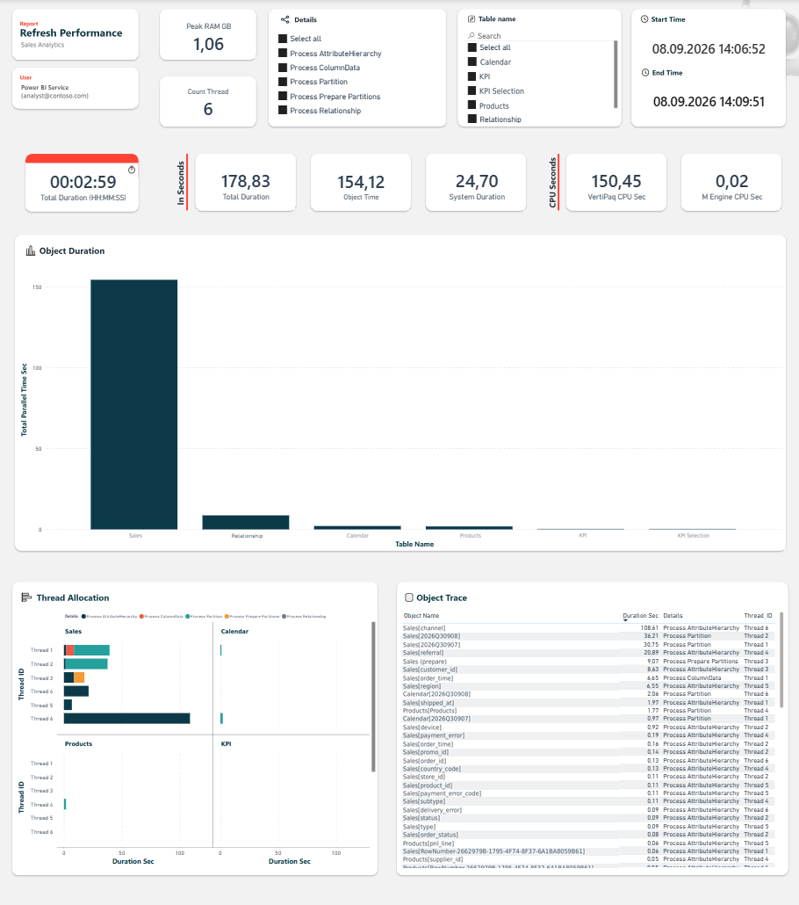
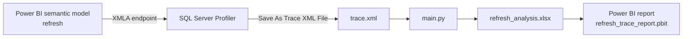
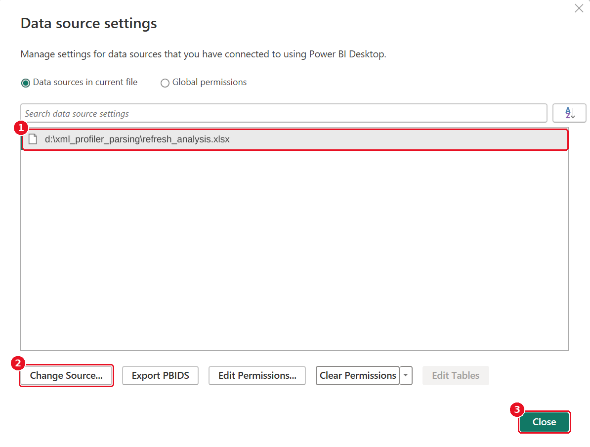
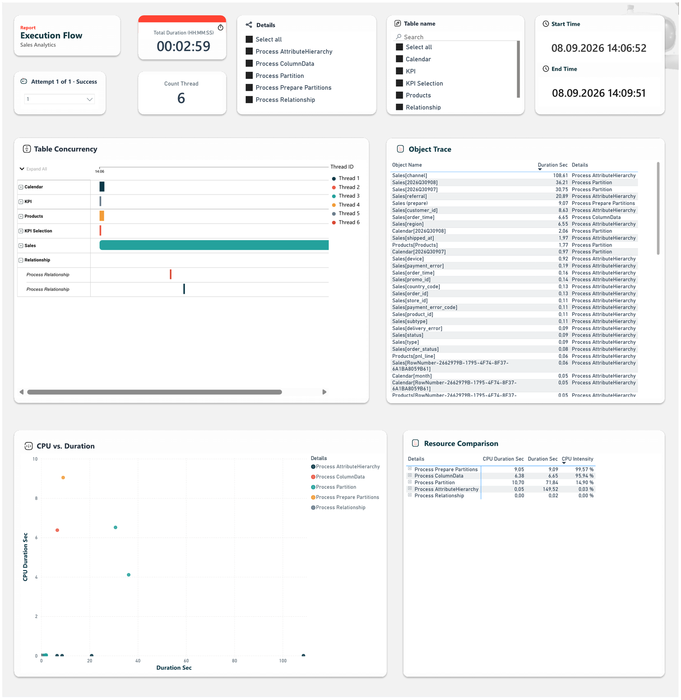
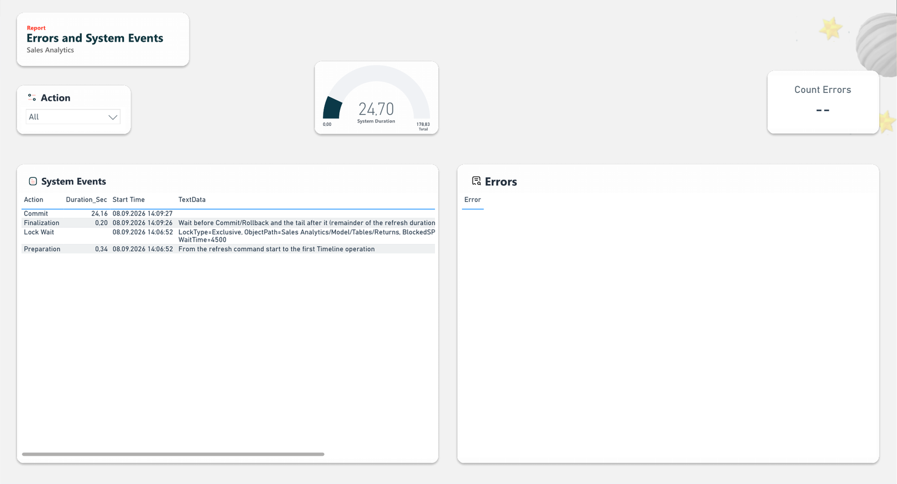

# Power BI Refresh Profiler

See what happens **inside** a Power BI semantic model refresh.

The refresh history in the Power BI Service tells you one thing: the refresh took 3 minutes. It does not tell you
which table took 2 of them. This project answers that question from an engine trace: one SQL Server Profiler
recording of the refresh, a Python parser, and a Power BI report that shows:

- which tables, partitions, columns and relationships took the longest;
- how the work was spread across parallel threads;
- where the rest of the time went: preparation, commit, waiting;
- errors, failed or cancelled operations, lock waits;
- peak memory and CPU time (VertiPaq and Mashup engine).



---

## At a glance

| | |
|---|---|
| **Input** | A SQL Server Profiler trace of one refresh, saved as Trace XML, recorded through the XMLA endpoint |
| **Engine data used** | Job Graph (millisecond timeline, thread slots, CPU per object), Execution Metrics (engine duration, peak memory, CPU split), Command and Progress Report events (commit, rollback, failures), Lock Waiting |
| **Output** | `refresh_analysis.xlsx` with 6 sheets, read by a 3-page Power BI template |
| **Accuracy** | The Timeline span plus the System Events adds up to the engine's own `durationMs`; checked on real traces and by the tests in `tests/` |
| **Scope** | One refresh session per trace; repeated attempts inside it are numbered and shown one by one. Tested on Import-mode models in the Power BI Service |
| **Stack** | Python 3.10+ with `pandas` and `openpyxl`; Power BI Desktop; SQL Server Profiler 18.9+ |

**Documentation:** this README covers usage. [docs/TECHNICAL.md](docs/TECHNICAL.md) covers the design decisions,
parsing algorithm, workbook schema, DAX, limitations and maintenance. [docs/PROFILER.md](docs/PROFILER.md) is a
click-by-click Profiler guide with screenshots.

---

## Contents

- [How it works](#how-it-works)
- [Try it with demo data](#try-it-with-demo-data)
- [Requirements](#requirements)
- [Quick start](#quick-start)
- [Step 1. Record a refresh in SQL Server Profiler](#step-1-record-a-refresh-in-sql-server-profiler)
- [Step 2. Run the script](#step-2-run-the-script)
- [Step 3. Open the report](#step-3-open-the-report)
- [How to read the report](#how-to-read-the-report)
- [What the report answers](#what-the-report-answers)
- [FAQ](#faq)
- [Troubleshooting](#troubleshooting)
- [Repository structure](#repository-structure)
- [License](#license)

---

## How it works



1. **SQL Server Profiler** records the engine events of one refresh and saves them as XML.
2. **`main.py`** keeps only the refresh session, rebuilds the timeline from the Job Graph, splits the rest of the
   refresh time into non-overlapping phases and writes the workbook.
3. The **Power BI report** reads the workbook.

---

## Try it with demo data

`demo/refresh_analysis_demo.xlsx` is the output of a real refresh of an Import-mode model. Model, user, table and
column names are replaced; all numbers are unchanged. It is the data behind the screenshots in this repository.

Open `refresh_trace_report.pbit` and point it to this file as described in [Step 3](#step-3-open-the-report).
`demo/refresh_analysis_failed_demo.xlsx` is a failed refresh with four attempts and out-of-memory errors; use it to see
page 3 with errors.
No Profiler, Python or Premium workspace needed.

---

## Requirements

| What | Notes |
|---|---|
| Python 3.10 or later | With `pandas` and `openpyxl` (`requirements.txt`) |
| SQL Server Profiler 18.9 or later | Installed with [SQL Server Management Studio](https://learn.microsoft.com/en-us/ssms/install/install) |
| Power BI Desktop | To open the report template |
| XMLA endpoint (Read) | **Workspace type** Premium Per-User (PPU), Premium, Fabric or Embedded. Pro workspaces cannot be traced |
| Access to the semantic model | The permissions needed to refresh it |

---

## Quick start

```bash
pip install -r requirements.txt
```

1. Record one refresh with SQL Server Profiler ([settings](#step-1-record-a-refresh-in-sql-server-profiler)) and save
   it as **Trace XML File** next to `main.py`.
2. Run `python main.py`. It writes `refresh_analysis.xlsx` next to the script.
3. Open `refresh_trace_report.pbit`, point it to the workbook ([Step 3](#step-3-open-the-report)) and save it as a
   `.pbix`. For every next trace: run the script, then **Home → Refresh**.

---

## Step 1. Record a refresh in SQL Server Profiler

> Never used Profiler? [docs/PROFILER.md](docs/PROFILER.md) walks through every window with screenshots.

### Settings

| Where | Setting | Value |
|---|---|---|
| Connect to Server → Login | Server type | Analysis Services |
| | Server name | The workspace **Connection link** (**Workspace settings → Workspace type**; older layouts: **License info**), e.g. `powerbi://api.powerbi.com/v1.0/myorg/Your Workspace` |
| | Authentication | Microsoft Entra MFA (*Active Directory – Universal with MFA* in older versions) |
| Connect to Server → Options → Connection Properties | Connect to database | The **exact name of the semantic model** (or **&lt;Browse server...&gt;**). Required: Profiler does not connect to a Power BI workspace without an initial catalog |
| Trace Properties → General | Use the template | Blank |
| Trace Properties → Events Selection | Show all events, Show all columns | Ticked |
| | Events | The events below, each with all its columns |

### Events

This table is the reference list of events (see [TECHNICAL.md](docs/TECHNICAL.md#trace-events-and-columns) for
how each one is parsed).

| Category | Event | Needed? | Without it |
|---|---|---|---|
| Command Events | Command Begin | Yes | The refresh session cannot be isolated from other activity in the trace |
| Command Events | Command End | Yes | No reference refresh duration: no Preparation and Finalization rows |
| Progress Reports | Progress Report Begin | Yes | The Unfinished sheet and the Unfinished Objects table stay empty: no objects that started and never finished |
| Progress Reports | Progress Report End | Yes | No Commit or Rollback; no fallback timeline |
| Progress Reports | Progress Report Error | Yes | Errors of the refresh are missing |
| Errors and Warnings | Error | Yes | Errors of the refresh are missing |
| Job Graph Events | Job Graph | Yes | No millisecond timeline and thread slots; the fallback has one-second precision |
| Execution Metrics Events | Execution Metrics | Yes | No peak memory and CPU split; no Preparation and Finalization rows |
| Locks | Lock Waiting | Recommended | Lock waits are not shown |
| Queries Events | Query End | Optional | Failed queries of the refresh session are not listed in Errors |
| Discover Events | Discover End | Optional | Failed discover requests of the refresh session are not listed in Errors |

Other events only make the file bigger.

> **Tip:** once the trace runs, **File → Save As → Trace Template** saves this setup for the next time.

### Record and save

1. **Run** the trace, then start the refresh of the same semantic model. **Job Graph** rows in the EventClass column
   mean the trace works.
2. When the refresh has finished: **File → Stop Trace**, then **File → Save As → Trace XML File** next to `main.py`.
   Not *Trace File*: that is a binary `.trc` the script cannot read.

One trace = one refresh. If the file contains more, the script takes the first one.

---

## Step 2. Run the script

```bash
python main.py
```

The script reads the only `.xml` file in its own folder and writes `refresh_analysis.xlsx` next to it (overwritten on
every run). Subfolders are not read, so `XML/` works as an archive for older traces.

Example output (names replaced):

```text
Using XML: C:\PowerBI-Refresh-Profiler\refresh_trace.xml
Main refresh command found. RequestID: 40328362-F5FB-491B-9A54-6DABE4CA9A53 | ActivityID: B362A292-2C4C-4440-B33A-9C4BC5D036AA
Main command finished. Collecting remaining metrics...
Final metrics collected. New session detected, stopping file read.

======================================
DATABASE:      Sales Analytics
USER:          Power BI Service (analyst@contoso.com)
TOTAL REFRESH: 179.157 sec
--------------------------------------
Errors / Failures: 0
Execution Metrics: 1
System Events:     4
Unfinished objects: 2
Attempt 1 (Success): 178.825 s, RequestID 40328362-F5FB-491B-9A54-6DABE4CA9A53
======================================

File successfully created: C:\PowerBI-Refresh-Profiler\refresh_analysis.xlsx
```

*TOTAL REFRESH* is the span of all events of the session, so it is slightly longer than the engine duration that the
report shows as **Total Duration** (179.157 vs. 178.83 seconds here).

---

## Step 3. Open the report

`refresh_trace_report.pbit` is a template: model, measures and visuals, no data. Its queries point to the folder
it was built in, so the first start needs one change of the data source.

1. Open the template. A **Refresh** window reports *"Could not find file '…\refresh_analysis.xlsx'"* for every table.
   Click **Close**.
2. **Home → Transform data ▾ → Data source settings** → select the source → **Change Source… → Browse…** → pick
   `refresh_analysis.xlsx` (or `demo/refresh_analysis_demo.xlsx`) → **OK → Close**.
3. Click **Apply changes** (or **Refresh now**) in the yellow bar. The cards fill with numbers.
4. **File → Save As** a `.pbix`. For every next trace: run `python main.py`, then **Home → Refresh**.

<details>
<summary>Screenshot: Data source settings</summary>



</details>

The Gantt chart is a Microsoft custom visual stored inside the file; nothing to install.

---

## How to read the report

### Page 1. Refresh Performance: where did the time go?


- **Total Duration** is the full refresh time; it equals the engine's `durationMs`.
- **Object Time** is the wall-clock span of the table processing, **System Duration** is everything else
  (preparation, commit, waiting). With no slicer selected, together they make Total Duration.
- **Object Duration** ranks the tables by the span of their processing.
- **Thread Allocation** shows the work per thread and table.
- **Peak RAM GB**, **VertiPaq CPU Sec** and **M Engine CPU Sec** are the engine's numbers for the selected attempt
  (Execution Metrics). **Count Thread** is the number of threads in the Timeline.
- The **Attempt** slicer picks the refresh attempt; its header shows, for example, *Attempt 2 of 4 · Failed*. A trace
  holds several attempts when Power BI retried a failed refresh in the same session. The first attempt is selected
  by default.
- **Object Trace** lists every partition, column and relationship with its duration and thread.
- The **Details** and **Table name** slicers filter by operation type or table.

### Page 2. Execution Flow: what ran in parallel?



- The **Attempt** slicer works as on page 1.
- **Table Concurrency** is a Gantt chart of every operation, coloured by thread. Overlapping bars ran in parallel;
  gaps mean waiting.
- **CPU vs. Duration**: one dot per object, wall-clock seconds against CPU seconds.
- **Resource Comparison**: CPU time, wall-clock time and **CPU Intensity** (CPU ÷ wall-clock) per operation type.

### Page 3. Errors & System Events: what else happened?



- **System Events** holds the non-overlapping parts of the refresh outside table processing:
  - **Preparation**: from the start of the refresh command to the first Job Graph operation;
  - **Commit** (or **Rollback** after a failure);
  - **Finalization**: the wait before Commit plus the tail after it, derived as the remainder;
  - **Lock Wait**: another session blocked the refresh; lock type, object and blocking SPID are in **TextData**.
- The **Attempt / Status** table lists the attempts with their status (Success or Failed). The **Attempt** slicer on this page
  allows several attempts at once.
- **Errors** lists every error and every failed or cancelled operation, oldest first: row 1 is the earliest error,
  usually the cause, and later rows are often its consequences. The table shows the first 95 characters; click a row
  to see the full text in **Error Details**. The **Errors action** slicer filters by event type: `Error` is the
  server's own message, `Progress Report Error` the failure of one table or partition, `Command End (Failed/Cancelled)`
  the failed refresh command.
- **Unfinished Objects** lists tables and partitions that started but logged no end, for failed attempts only: what
  was being processed when the refresh broke. On a successful refresh it shows *none*.

### Operation types

The **Details** slicer and column use the Job Graph operation names:

| Operation | What the engine does |
|---|---|
| Process Partition | Loads the data of one partition from the source |
| Process Prepare Partitions | Prepares a table before its partitions are loaded |
| Process AttributeHierarchy | Builds the attribute hierarchy of one column (used for filtering and grouping) |
| Process Relationship | Builds the index of one relationship |
| Process ColumnData | Processes the data of one column after loading. Microsoft does not document this step in detail |

The DAX behind every card: [TECHNICAL.md → Report measures](docs/TECHNICAL.md#report-measures).

---

## What the report answers

The report shows how the engine executed one refresh. The conclusions for your model are yours to draw.

| Question | Where |
|---|---|
| How long did the refresh take in the engine, and how much of it was table processing? | Page 1: Total Duration, Object Time, System Duration |
| Which tables, partitions, columns and relationships took the longest? | Page 1: Object Duration, Object Trace |
| Which operation type takes the time: partitions, column data, hierarchies, relationships? | **Details** slicer; Page 2: Resource Comparison |
| How much of an operation's wall-clock time was CPU? | Page 2: CPU vs. Duration, CPU Intensity |
| How many threads worked, and how was the work spread across them? | Page 1: Count Thread, Thread Allocation |
| What ran in parallel, and in which order? | Page 2: Table Concurrency |
| How long did preparation, commit and the wait around commit take? | Page 3: System Events, Total System Duration |
| Was the refresh blocked by a lock, and on which object? | Page 3: Lock Wait rows (object and blocking SPID in TextData) |
| What failed or was cancelled, and with which error? | Page 3: Errors, Error Details |
| Was the refresh retried, and which attempts failed? | Page 3: Attempt / Status table; **Attempt** slicer on every page |
| Which tables were being processed when a refresh failed? | Page 3: Unfinished Objects |
| What was the peak memory, and how was CPU split between the M engine and VertiPaq? | Page 1: Peak RAM GB, VertiPaq CPU Sec, M Engine CPU Sec |

Not covered:

- the inside of a partition load: Power Query steps and the source query are one Process Partition operation;
- memory per table: Peak RAM is for the whole refresh;
- DAX query performance;
- trends: one trace is one refresh. To compare runs, compare their workbooks.

---

## FAQ

**Why do Object Time and System Duration add up to Total Duration?**
The script splits the refresh into parts that do not overlap. In the demo: 154.12 + 24.70 = 178.83 seconds, give or
take rounding. Full breakdown: [TECHNICAL.md → How the duration adds up](docs/TECHNICAL.md#how-the-refresh-duration-adds-up).

**Lock Wait has no duration. Is that a bug?**
No. The event has no Duration column, and its `WaitTime` value is undocumented and does not fit the traced timeline.
The details stay in TextData.

**Many Timeline rows have Duration 0. Did they not run?**
They ran. Start and end fall inside the same timestamp of the Job Graph and CPU time is 0, so the operation was too
short to measure. They are not skipped.

**An object is on the Unfinished sheet. Did the refresh fail?**
Not necessarily. The sheet lists objects with a start event and no end event in the trace. The engine does not always
log an end for a relationship build, and the refresh still succeeds. Check the Errors sheet for failures. The report
shows unfinished objects only for failed attempts.

**The report shows several attempts. Which one is the refresh?**
Each refresh command in the trace session is an attempt, numbered by start time. When Power BI retries a failed refresh
in the same session, the earlier attempts are rolled back and the last one is the final result. Their errors are
usually the same; compare them on page 3.

**Is my data sent anywhere?**
No. Everything runs locally. Traces (`.xml`) and workbooks (`.xlsx`) contain model, server and user names and are
excluded by `.gitignore`; only the anonymised demo workbook is committed.

---

## Troubleshooting

| Message or symptom | Cause | Fix |
|---|---|---|
| `No XML files found.` | No `.xml` next to `main.py`, or the trace was saved as *Trace File* (`.trc`) | Save it as **Trace XML File** next to `main.py` |
| `More than one XML found next to main.py…` | Several traces in the folder | Keep one, move the rest to `XML/` |
| `No events found. Excel file was not updated.` | The trace has no refresh | Check the events and that the refresh ran while recording |
| `Main refresh command found` is not printed | `Command Begin` was not recorded | Add the event |
| `WARNING: the refresh phases exceed the refresh command duration` | Timeline or Commit reach past the end of the refresh command, usually on a failed refresh | Finalization is shown as 0; the overshoot is in its `TextData` |
| `WARNING: required events are missing in the trace` | Some events were not ticked in Profiler; the message lists them and what the output loses | Tick them (Step 1, Events) and record again. Error, Progress Report Error, Lock Waiting, Query End and Discover End cannot be checked this way: they appear only when something fails or waits |
| No Preparation / Finalization rows | `Execution Metrics` or `Command End` was not recorded | Add both events |
| *Could not find file '…\refresh_analysis.xlsx'* when opening the template | The template points to the folder it was built in | [Step 3](#step-3-open-the-report) |

Profiler problems (connection, missing events, no Job Graph rows): [PROFILER.md → If something goes wrong](docs/PROFILER.md#if-something-goes-wrong).

---

## Repository structure

```text
.
├── main.py                        # parser: trace XML in, workbook out
├── requirements.txt               # pandas, openpyxl
├── refresh_trace_report.pbit      # Power BI report template (no data)
├── demo/
│   ├── refresh_analysis_demo.xlsx        # anonymised output of a real refresh, to try the report
│   └── refresh_analysis_failed_demo.xlsx # anonymised failed refresh with four attempts (page 3 screenshot)
├── docs/
│   ├── TECHNICAL.md               # design, algorithm, workbook, DAX, limitations, maintenance
│   ├── PROFILER.md                # click-by-click Profiler guide with screenshots
│   └── images/                    # screenshots (demo data)
├── tests/
│   ├── test_main.py               # python -m unittest discover tests
│   ├── make_fixture.py            # builds the synthetic test traces
│   └── fixtures/
│       ├── sample_refresh_trace.xml
│       └── two_attempts_trace.xml
├── XML/                           # archive for your traces: not read by the script, ignored by Git
├── LICENSE
└── README.md
```

---

## License

[Apache License 2.0](LICENSE).
