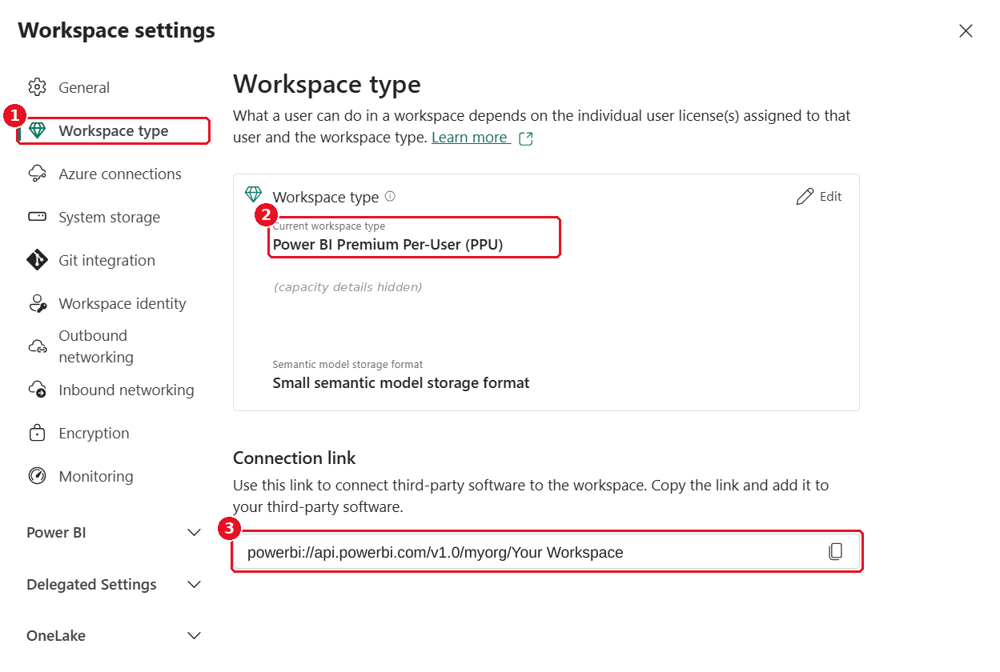
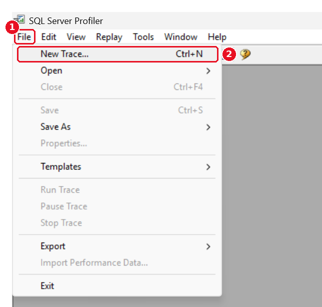
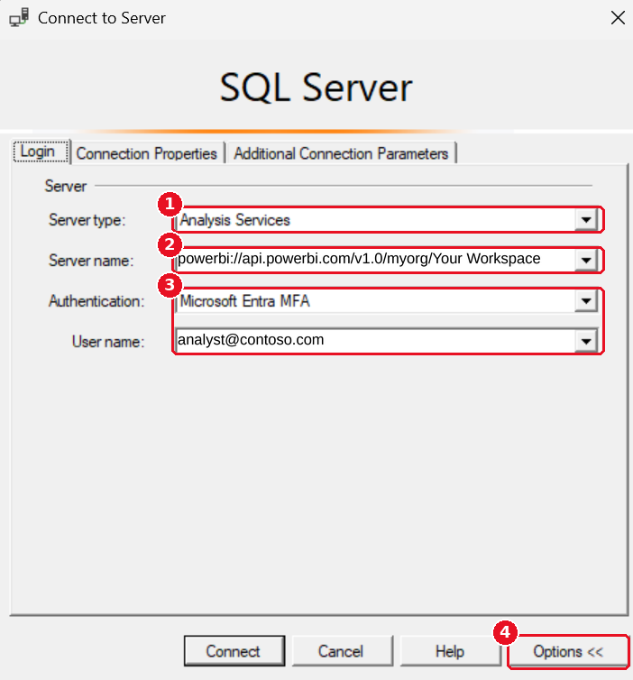
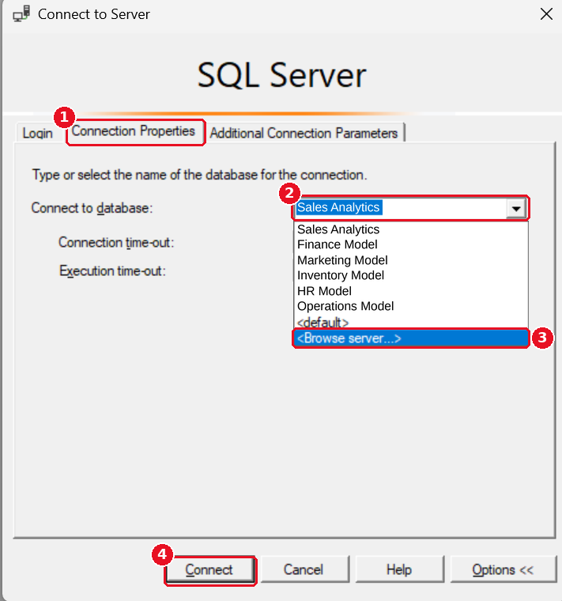
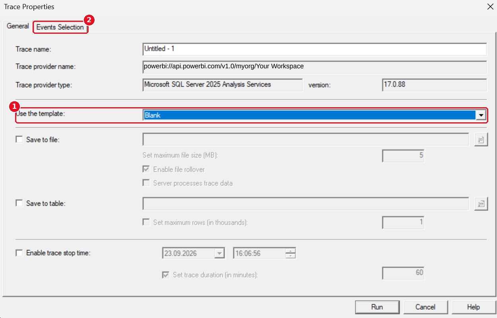
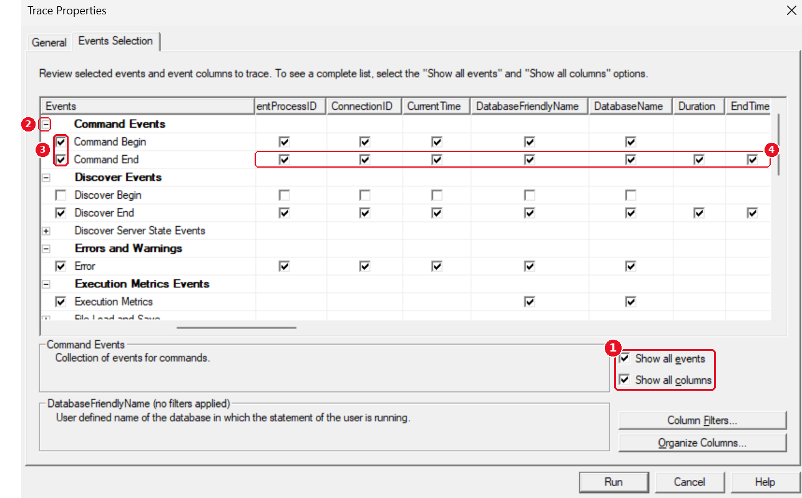
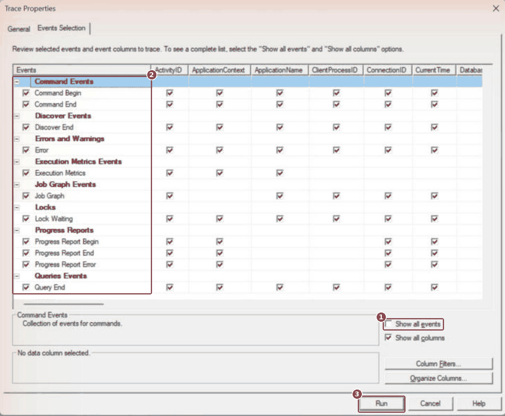
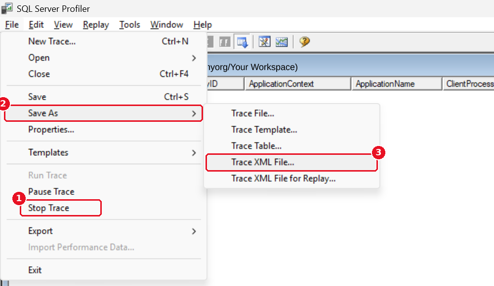

# Recording a refresh trace with SQL Server Profiler

A click-by-click guide for recording the trace that `main.py` reads. The same settings in one table:
[README, Step 1](../README.md#step-1-record-a-refresh-in-sql-server-profiler).

The numbers in red circles on the screenshots match the numbers in the text.

---

## Contents

- [Before you start](#before-you-start)
- [1. Install SQL Server Profiler](#1-install-sql-server-profiler)
- [2. Copy the workspace address](#2-copy-the-workspace-address)
- [3. Start a new trace](#3-start-a-new-trace)
- [4. Fill in the server](#4-fill-in-the-server)
- [5. Choose the semantic model and connect](#5-choose-the-semantic-model-and-connect)
- [6. Pick the Blank template](#6-pick-the-blank-template)
- [7. Select the events and start the trace](#7-select-the-events-and-start-the-trace)
- [8. Run the refresh](#8-run-the-refresh)
- [9. Stop and save as Trace XML File](#9-stop-and-save-as-trace-xml-file)
- [If something goes wrong](#if-something-goes-wrong)

---

## Before you start

- The workspace type is Premium Per-User (PPU), Premium, Fabric or Embedded, with the XMLA endpoint enabled.
- You know the exact name of the semantic model and can start its refresh.

---

## 1. Install SQL Server Profiler

Profiler is installed with [SQL Server Management Studio](https://learn.microsoft.com/en-us/ssms/install/install).
Open it from the Start menu (*SQL Server Profiler*) or in SSMS: **Tools → SQL Server Profiler**.

---

## 2. Copy the workspace address



In the Power BI Service open the workspace → **Workspace settings**:

1. Open **Workspace type**.
2. The type must be Premium Per-User (PPU), Premium, Fabric or Embedded. *Pro* cannot be traced.
3. Copy the **Connection link**.

In older layouts the link is under **License info** or **Premium → Workspace Connection**. It looks like this:

```text
powerbi://api.powerbi.com/v1.0/myorg/Your Workspace
```

---

## 3. Start a new trace



1. Open the **File** menu.
2. Click **New Trace...** (or press Ctrl+N). The **Connect to Server** window opens.

---

## 4. Fill in the server



1. **Server type:** Analysis Services.
2. **Server name:** paste the Connection link from step 2.
3. **Authentication:** *Microsoft Entra MFA* (*Active Directory – Universal with MFA* in older versions) and your
   work account.
4. Click **Options >>** (it then reads **Options <<**, as on the screenshot). Do not click Connect yet.

---

## 5. Choose the semantic model and connect



1. Open the **Connection Properties** tab.
2. **Connect to database:** type the exact name of your semantic model.
3. Or pick **&lt;Browse server...&gt;**: Profiler asks you to sign in, then shows the models of the workspace and you
   choose yours from the list.
4. Click **Connect**. A Microsoft sign-in window may appear; complete it. Then the **Trace Properties** window opens.

> **Do not skip point 2 or 3.** Without a model name (initial catalog) Profiler cannot connect to a Power BI
> workspace.

---

## 6. Pick the Blank template



1. **Use the template:** Blank.
2. Open the **Events Selection** tab.

*Save to file* and *Save to table* stay unticked: the trace is saved as XML at the end (step 9).

---

## 7. Select the events and start the trace



1. Tick **Show all events** and **Show all columns**.
2. Click **+** in front of a category (here *Command Events*). Its events appear below it.
3. Tick the checkbox at the very left of each event from the checklist below.
4. The row fills with ticks: the event is selected with all its columns. Empty cells mean the event has no such
   column.

**Checklist** (in the order of the Events list):

- **Command Events:** Command Begin, Command End
- **Discover Events:** Discover End (optional)
- **Errors and Warnings:** Error
- **Execution Metrics Events:** Execution Metrics
- **Job Graph Events:** Job Graph
- **Locks:** Lock Waiting (recommended)
- **Progress Reports:** Progress Report End, Progress Report Error
- **Queries Events:** Query End (optional)

Leave everything else unticked. What each event is for: [README → Events](../README.md#events).

**Check before you start:**



1. Untick **Show all events**. The list now shows only the events you selected.
2. Compare it with the screenshot: 10 events in 8 categories.
3. Click **Run**. The trace starts and an empty grid opens.

> **Do this setup once.** After **Run**: **File → Save As → Trace Template**, for example *Power BI refresh*. Next
> time pick it in step 6 instead of Blank; step 7 is then only **Run**.

---

## 8. Run the refresh

1. Start the refresh of the same semantic model (Refresh now, a scheduled refresh or any other way).
2. When **Job Graph** appears in the EventClass column, the trace records what the script needs.
3. Wait until the refresh has finished. A failed refresh is fine too: the report shows what went wrong.

Record **one refresh per trace**. If the file contains more, the script analyses the first one.

---

## 9. Stop and save as Trace XML File



1. **File → Stop Trace** (or the red square on the toolbar).
2. **File → Save As**.
3. **Trace XML File...** Save it in the project folder, next to `main.py`.

Not *Trace File*: that is a binary `.trc` file the script cannot read.

**Next:** run the script, see [README, Step 2](../README.md#step-2-run-the-script).

---

## If something goes wrong

| Problem | What to check |
|---|---|
| Profiler cannot connect | The XMLA endpoint must be enabled in the admin settings; the model name in **Connect to database** must match exactly |
| The model is not in the Connect to database list | Type the name by hand, or use **&lt;Browse server...&gt;** |
| The events are not in the Events list | Tick **Show all events** and **Show all columns** (step 7) |
| No rows appear after Run | The refresh has not started yet, or it runs on another model than the one in **Connect to database** |
| No **Job Graph** rows | The Job Graph event is not ticked (step 7) |
| Profiler from SSMS 22 cannot connect to the workspace | A colleague could not connect with Profiler from SSMS 22; the one from SSMS 21 connected to the same workspace. Not verified further, try the older SSMS if the connection fails with the correct address |

Messages of the script: [README → Troubleshooting](../README.md#troubleshooting).
