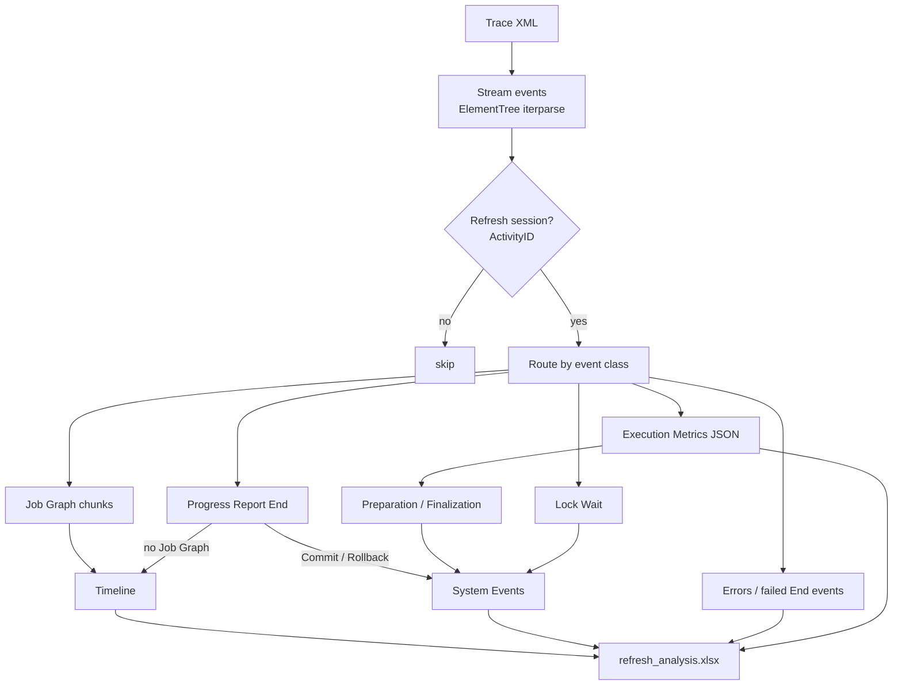

# Technical reference

How the parser reads a refresh trace, what every sheet and column means, how the report numbers are calculated, and
how to change the project safely. For setup and daily use see the [README](../README.md); for recording a trace step
by step see [PROFILER.md](PROFILER.md).

## Contents

- [Architecture](#architecture)
- [Design decisions](#design-decisions)
- [Trace events and columns](#trace-events-and-columns)
- [Parsing algorithm](#parsing-algorithm)
- [Output workbook](#output-workbook)
- [How the refresh duration adds up](#how-the-refresh-duration-adds-up)
- [Report data model](#report-data-model)
- [Report measures](#report-measures)
- [Precision and limitations](#precision-and-limitations)
- [Tested with](#tested-with)
- [Source of truth and interface contract](#source-of-truth-and-interface-contract)
- [Demo data](#demo-data)
- [Extending the parser](#extending-the-parser)
- [Maintenance checklist](#maintenance-checklist)

---

## Architecture



- Single file, `main.py`, standard library plus `pandas` and `openpyxl`.
- The XML is read as a stream, so large traces do not have to fit in memory as a DOM, and the read stops at the first
  event of another session after the refresh. A 20.5 MB trace took 0.35 s and 1.0 s on the two environments in
  [Tested with](#tested-with).
- Paths are resolved from the script folder (`SCRIPT_DIR`), not from the working directory.
- The workbook always gets all six sheets with all columns, even when a sheet has no rows, so the Power Query steps
  in the report never break on a missing column.

---

## Design decisions

| Decision | Why | Trade-off |
|---|---|---|
| Input is a **Trace XML File**, not a `.trc` | XML is read with the Python standard library; `.trc` is a binary format that needs SQL Server tooling | The user must pick *Save As → Trace XML File* |
| **Job Graph** is the primary source of the Timeline | Millisecond start/end, thread slot and CPU for every object in one event | Undocumented format; `Progress Report End` is kept as a fallback with one-second precision |
| The refresh is found by **command text markers + matching EventSubclass**, the session by **ActivityID** | Traces also contain service batches, discover requests and other sessions that start first or run in parallel | Only the first refresh of a trace is analysed |
| **System Events do not overlap** each other or the Timeline | `Timeline span + System Events = engine duration`, so the sheet can be summed and the report total matches `durationMs` | Nested phases (Backup, commit phases, Sequence point) are not listed; Finalization is a remainder |
| **Lock Wait has no duration** | `WaitTime` is undocumented and did not fit the traced timeline | Lock waits are shown as events with details, not as time |
| **Excel workbook** between script and report | Power BI reads it natively, people can open and check it, no database needed | Fixed sheet and column names form an interface (see below) |
| Report shipped as **`.pbit` without data** | No model, server or user data in the repository | The data source path has to be changed once on the first start |
| The script reads **only its own folder** | Deterministic input: one XML, one output; `XML/` works as an archive | Traces have to be moved in and out of the project folder |
| Tests run on a **synthetic trace** (`tests/`) | Real traces contain model, server and user names and stay out of Git; a generated trace with the same XML structure covers the session filter, Job Graph parsing, the phase split and the duration sum | It follows the formats of the tested traces; after a service change, check a real trace as well |

---

## Trace events and columns

### Events

| Event (as saved in XML) | Profiler category | Required | Used for |
|---|---|---|---|
| Command Begin | Command Events | Yes | Finds the refresh command and its session (`ActivityID`). Without it, events of other sessions stay in the output |
| Command End | Command Events | Yes | Subclass 38 is the whole refresh command; its `Duration` is the reference refresh duration. `Success = 0` goes to Errors |
| Progress Report End | Progress Reports | Yes | Subclass 6 Commit, 7 Rollback; Timeline fallback when there is no Job Graph; `Success = 0` goes to Errors |
| Progress Report Error | Progress Reports | Yes | Errors |
| Error | Errors and Warnings | Yes | Errors |
| Job Graph | Job Graph Events | Yes | Timeline with exact start, end, thread slot and CPU of every node |
| Execution Metrics | Execution Metrics Events | Yes | `timeStart` of the refresh request (for Preparation), duration, peak memory, CPU split |
| Lock Wait | Locks (*Lock Waiting* in the Profiler UI) | Recommended | Lock Wait rows in System Events |
| Query End | Queries Events | Optional | `Success = 0` goes to Errors |
| Discover End | Discover Events | Optional | `Success = 0` goes to Errors |

Progress Report End subclasses that are refresh phases rather than object processing:

| Subclass | Name | Where it goes |
|---|---|---|
| 6 | Commit | System Events |
| 7 | Rollback | System Events and Errors |
| 37 | Backup | Not listed: runs inside Commit |
| 52 | Backup metadata | Not listed: runs inside Commit |
| 57 | Tabular commit phase | Not listed: runs inside Commit |
| 58 | Sequence point | Not listed: overlaps the Timeline |

Listing the nested phases would count the same seconds twice, and the System Events sheet could no longer be summed.

### Columns

| Column | Used for |
|---|---|
| ActivityID | Session filter (required) |
| RequestID | Groups Job Graph chunks; links Execution Metrics and Command End to the refresh request |
| TextData | Refresh command text, Job Graph XML, metrics JSON, error text, lock details |
| EventSubclass | Commit / Rollback, refresh command (38), Job Graph chunk type |
| IntegerData | Order of Job Graph chunks |
| StartTime, CurrentTime | Event time (`CurrentTime` when `StartTime` is empty) |
| Duration, CPUTime | Operation duration and CPU (milliseconds) |
| Success | Failed or cancelled operations |
| Error | Error number |
| DatabaseName, NTUserName | Summary Info |

---

## Parsing algorithm

1. **Pick the trace.** Exactly one `*.xml` next to `main.py`. The search is not recursive, so subfolders
   (including the `XML/` archive) are ignored. Windows `glob` is
   case-insensitive, so the results of `*.xml` and `*.XML` are de-duplicated.

2. **Find the refresh command.** The first `Command Begin` whose `TextData` contains one of
   `"refresh":` (TMSL), `<refresh` or `<process` (XMLA) is the refresh. Its `RequestID`, `ActivityID` and
   `EventSubclass` are stored. Discover batches (`<Batch><Discover>`) contain none of these markers, so they are not
   taken for the refresh, even when they start first.

3. **Filter the session.** Every event whose `ActivityID` differs from the refresh session is skipped. Events read
   before the refresh command was found (errors, lock waits, Commit / Rollback, Job Graph chunks, Progress Report End)
   keep their `ActivityID` and pass the same filter after the read, so a failed query of another session that ran
   before the refresh does not reach Errors. Events without `ActivityID` are kept.

4. **Detect the end.** The refresh has ended at the `Command End` with the same `RequestID` **and** the same subclass
   as the `Command Begin`. After that the parser still reads the trailing Execution Metrics of the session, and stops
   at the first event of another session.

5. **Build the Timeline from the Job Graph.** Job Graph text arrives in chunks per `RequestID`; `IntegerData` gives the
   order. The chunks are joined and every `<Node … />` is read:

   | Node attribute | Timeline column |
   |---|---|
   | `Label` | `ObjectName`, `TableName`, `Details` (the operation prefix is split off the label) |
   | `Slot` | `Thread_ID` = `Thread {Slot + 1}` |
   | `StartedAt`, `FinishedAt` | `StartTime`, `EndTime`, `Duration_Sec` |
   | `Cpu` | `CPU_Duration_Sec` |

   Name rules: the `<oii>` / `<pii>` markers Power BI wraps around identifiers are removed; for internal hierarchy
   objects (`H$Table (id)$Column (id)`) the table name is taken from the second part; the Prepare Partitions step
   becomes `Table (prepare)`; relationships become `Relationship[<id>]` with `TableName = Relationship`.

6. **Timeline fallback.** When the trace has no Job Graph, the Timeline is built from `Progress Report End` events
   (one-second time precision). Threads are assigned by greedy interval scheduling: each event goes to the first
   thread that is free at its start time.

7. **System Events.** Commit / Rollback rows come from `Progress Report End` (6 / 7). Lock Wait rows keep the raw
   `TextData` (`LockType`, `ObjectPath`, `BlockedSPID`, `BlockingSPID`, `WaitTime`). Deadlock events are not listed:
   the command cancelled by a deadlock already appears in Errors.

8. **Preparation and Finalization** (`add_refresh_phases`), for each attempt, from its own operations, Commit or
   Rollback (`Shutdown after failure` instead of `Finalization` for a failed attempt):

   ```text
   Preparation  = first Timeline start − Execution Metrics timeStart
   Processing   = last Timeline end − first Timeline start          (not written; the report takes it from Timeline)
   Finalization = Command End duration − Preparation − Processing − Commit/Rollback
   ```

   Execution Metrics timestamps carry `Z`, other events a local offset, for the same clock. They are compared as
   wall-clock values (time zone dropped).

   Timestamp parsing (`parse_pbi_time`) cuts or pads the fraction of a second to 6 digits and keeps the zone offset,
   because `datetime.fromisoformat` in Python 3.10 accepts only 3 or 6 fractional digits and a full `+HH:MM` offset.
   Without it, Job Graph times such as `12:06:52.780Z` are rejected on 3.10 and the Timeline is empty.

9. **Execution Metrics.** Only the refresh commands (attempts) are kept. Requests shorter than one second with no memory and no
   CPU are noise and dropped. JSON fields used:

   | JSON field | Column |
   |---|---|
   | `commandType`, `objectPath.table` | Command Type |
   | `refreshParallelism` | Refresh Parallelism |
   | `durationMs` / 1000 | Duration Sec |
   | `approximatePeakMemConsumptionKB` / 1024² | Peak RAM GB |
   | `totalCpuTimeMs` / 1000 | Total CPU Sec |
   | `mEngineCpuTimeMs` (or `queryProcessingCpuTimeMs`) / 1000 | M Engine CPU Sec |
   | `vertipaqJobCpuTimeMs` (or total − M engine) / 1000 | VertiPaq CPU Sec |
   | `timeStart`, `timeEnd` | StartTime, EndTime |

10. **Errors.** `Error` and `Progress Report Error` events, every `Command / Progress Report / Query / Discover End`
    with `Success = 0`. A failed refresh does not always raise its own `Error` event, so the parser
    does not rely on it alone. Commit and Rollback are not listed: they carry no `TextData`, and the Rollback is already
    in System Events with its duration.

11. **Write the workbook** with `openpyxl`. Each sheet is re-indexed to its fixed column list.

The console line `TOTAL REFRESH` is the span of the processed events (first start to last end), so it is slightly longer
than the engine duration in Execution Metrics.

---

## Output workbook

### Summary Info

| Column | Description |
|---|---|
| Database | Semantic model: `DatabaseName` of the refresh command (the first one seen if the command has none) |
| User | `NTUserName` of the refresh command, the account that started the refresh (the first one seen if the command has none) |
| StartTime, EndTime | First and last event time of the processed part of the trace |

### Timeline

One row per Job Graph node. Sorted by duration, longest first.

| Column | Type | Description |
|---|---|---|
| ObjectName | text | `Sales[2026Q3]`, `Sales[Amount]`, `Sales (prepare)`, `Relationship[<id>]` |
| TableName | text | Owning table, or `Relationship` |
| Duration_Sec | number | Wall-clock seconds |
| CPU_Duration_Sec | number | CPU seconds |
| Thread_ID | text | `Thread 1` … `Thread n` |
| Details | text | `Process Partition`, `Process ColumnData`, `Process AttributeHierarchy`, `Process Prepare Partitions`, `Process Relationship`, … |
| StartTime, EndTime | datetime | Millisecond precision |
| RequestID | text | Refresh request |

### System Events

Non-overlapping parts of the refresh that are not object processing. Sorted by start time.

| Action | Duration_Sec | Meaning |
|---|---|---|
| Preparation | yes | Transaction start, metadata discovery, calculation scripts, up to the first node |
| Commit | yes | Writing the new data to the model (backup and commit phases run inside it) |
| Rollback | yes | Replaces Commit when the refresh failed or was cancelled |
| Finalization | yes | Successful attempt: wait before Commit plus the tail after it |
| Shutdown after failure | yes | Failed attempt: from the last Timeline operation to the end of the command, without Rollback |
| Lock Wait | empty | Another session held a lock the refresh needed. Details in TextData |

Columns: `Action`, `Duration_Sec`, `StartTime`, `RequestID`, `TextData`.

Preparation and Finalization (or Shutdown after failure) are written for every attempt. If an attempt has no
Execution Metrics event, its start is taken from `Command Begin`, which is logged to the second; the Preparation row
says so in `TextData`.

### Errors

Columns: `ID`, `Action`, `TextData`, `Error` (error number), `StartTime`, `RequestID`.

`ID` is a number from 1, assigned after sorting by `StartTime`, oldest first. Row 1 is the earliest error of the trace and
the likely root cause; the rows after it are often consequences (cancelled commands, rollbacks). The trace lists events
in the order they finish, so without the sort the failure would come before the errors that caused it.

### Unfinished

Objects with a `Progress Report Begin` and no matching `Progress Report End`. Only End events reach the Timeline, so
an object that started and then failed, was cancelled or was still running when the trace stopped is not visible
there. Begin and End are matched on `RequestID`, `EventSubclass`, `ObjectPath` and `StartTime`; the texts differ
("Started…" and "Finished…"), so they cannot be compared. Refresh phases (Commit, Rollback, Sequence point and so on)
are left out. The sheet is empty when every object finished.

Columns: `ObjectName`, `EventSubclass`, `Details`, `StartTime`, `Open_Until_Trace_End_Sec` (time from the start to the
end of the processed trace), `RequestID`.

A refresh can succeed with a few unfinished objects: the engine does not always log an End for a relationship build.
Treat the sheet as a list to look at, not as an error list.

### Execution Metrics

One row per attempt. A trace can hold several attempts of the same refresh in one session (the earlier ones failed and
were rolled back); each refresh command (`Command End`, subclass 38) is an attempt. The report builds its list of
attempts (`RequestID` slicer) from this sheet, so an attempt without an Execution Metrics event still gets a row:
`Command Type` = `Refresh (no Execution Metrics)`, duration and times from its Command Begin / End, memory and CPU
empty.

| Column | Description |
|---|---|
| Command Type, Refresh Parallelism, Duration Sec, Peak RAM GB, Total CPU Sec, M Engine CPU Sec, VertiPaq CPU Sec, StartTime, EndTime | From the Execution Metrics JSON (table in step 9 of the algorithm) |
| RequestID | Key to the other sheets |
| Attempt | 1, 2, 3… by command start, 1 = earliest |
| Status | `Success`: Command End with `Success = 1` and no Rollback. `Failed`: everything else |

---

## How the refresh duration adds up

```text
Preparation + Timeline span + Commit (or Rollback) + Finalization = Execution Metrics "Duration Sec"
```

Example from a real trace:

| Part | Seconds | Source |
|---|---|---|
| Preparation | 0.343 | refresh start 14:06:52.437 → first node 14:06:52.780 |
| Timeline span | 154.121 | first node → last node 14:09:26.901 |
| Commit | 24.157 | Progress Report End, subclass 6 |
| Finalization | 0.204 | remainder |
| **Total** | **178.825** | = `durationMs` in Execution Metrics = `Duration` of the refresh Command End |

Preparation is the difference of two logged timestamps. Only Finalization is derived, and it stays small
(0.2 s here) because the other three parts are measured.

On the three traces tested, the `Duration` of the refresh Command End was equal to `durationMs` in Execution Metrics,
so the report total matches the engine's own number.

---

## Report data model

The report (`refresh_trace_report.pbit`) loads the six sheets as six tables and adds one more, `dim_request`, the list of
refresh attempts.

| Report table | Source |
|---|---|
| Main | Timeline sheet |
| System Events | System Events sheet |
| Errors | Errors sheet |
| Execution Metrics | Execution Metrics sheet |
| Unfinished | Unfinished sheet |
| Summary Info | Summary Info sheet |
| dim_request | Built in Power Query from Execution Metrics: `RequestID`, `Attempt`, `Status`, one row per attempt |

Relationships, all on `RequestID`:

| From | To | Cardinality | Filter direction |
|---|---|---|---|
| Execution Metrics | dim_request | one to one | both |
| Main | dim_request | many to one | single |
| System Events | dim_request | many to one | single |
| Errors | dim_request | many to one | single |
| Unfinished | dim_request | many to one | single |

Summary Info is not related: it describes the whole trace (model, user, first and last event).

The **Attempt** slicer on every page filters `dim_request`, and through it every table. Pages 1 and 2 use single
select, so their numbers always describe one attempt; page 3 allows several attempts at once. With one attempt in the
trace the slicer has one value.

All queries read one source, `refresh_analysis.xlsx`. Changing it once in **Data source settings** updates them all.

---

## Report measures

```dax
Total Parallel Time Sec =
VAR MinStart = MIN ( 'Main'[StartTime] )
VAR MaxEnd   = MAX ( 'Main'[EndTime] )
RETURN ( MaxEnd - MinStart ) * 86400
```

Wall-clock span of the Timeline rows in the current filter. Parallel operations are counted once, which is why it is
used instead of `SUM(Duration_Sec)`.

```dax
Total Duration (HH:MM:SS) =
VAR IsMainFiltered =
    ISFILTERED ( 'Main'[Details] ) || ISFILTERED ( 'Main'[TableName] )
        || ISFILTERED ( 'Main'[ObjectName] ) || ISFILTERED ( 'Main'[Thread_ID] )
VAR TimelineSec = [Total Parallel Time Sec]
VAR SystemSec =
    IF ( NOT IsMainFiltered, SUM ( 'System Events'[Duration_Sec] ) )
VAR TotalSeconds =
    ROUND ( COALESCE ( TimelineSec, 0 ) + COALESCE ( SystemSec, 0 ), 0 )
VAR Hrs  = QUOTIENT ( TotalSeconds, 3600 )
VAR Mins = MOD ( QUOTIENT ( TotalSeconds, 60 ), 60 )
VAR Secs = MOD ( TotalSeconds, 60 )
RETURN
    FORMAT ( Hrs, "00" ) & ":" & FORMAT ( Mins, "00" ) & ":" & FORMAT ( Secs, "00" )
```

With no filter on the Timeline columns this is the full refresh of the selected attempt (Timeline span + System
Events). When a table, operation type, object or thread is selected, System Events are not added, because they do not
belong to one table. The check looks at the Timeline columns, not at the whole table: the Attempt slicer filters Main
through `dim_request`, and `ISCROSSFILTERED ( 'Main' )` would then drop System Events for every attempt.

| Measure | Expression |
|---|---|
| Cnt Thread ID | `DISTINCTCOUNTNOBLANK ( Main[Thread_ID] )` |
| CPU Intensity | `DIVIDE ( [Sum of CPU Duration Sec], [Sum of Duration Sec], 0 )` |
| Sum of Duration Sec | `SUM ( Main[Duration_Sec] )` |
| Sum of CPU Duration Sec | `SUM ( Main[CPU_Duration_Sec] )` |
| Sum of System Duration Sec | `SUM ( 'System Events'[Duration_Sec] )` |
| Sum of Execution Duration Sec | `SUM ( 'Execution Metrics'[Duration Sec] )` |
| Max of Peak RAM GB | `MAX ( 'Execution Metrics'[Peak RAM GB] )` |
| Max of Thread Parallelism | `MAX ( 'Execution Metrics'[Refresh Parallelism] )` (not used on the report pages) |
| Sum of VertiPaq CPU Sec | `SUM ( 'Execution Metrics'[VertiPaq CPU Sec] )` |
| Sum of M Engine CPU Sec | `SUM ( 'Execution Metrics'[M Engine CPU Sec] )` |
| Count Errors | `COUNTROWS ( Errors ) + 0` (shows 0, not blank, when there are no errors) |
| Attempt Info | `"Attempt 1 of 4 · Failed"` for the selected attempt, or `"4 attempts selected"` |
| Error Details | Full `TextData` of the error selected in the Errors table, otherwise a hint to select a row |
| Unfinished Title | Title of the Unfinished Objects table: `"Unfinished Objects: none"` or the number of rows |

`TextData Short` is a calculated column in Errors: `TextData` without line breaks, cut to 95 characters. The Errors table
shows it; the full text is in Error Details.

**Reading CPU Intensity.** Close to 100 %: the engine was busy (compression, encoding, hierarchies). Low: the
operation mostly waited, usually for the data source during Process Partition.

---

## Precision and limitations

- **One refresh session per trace.** Reading stops when another session starts after the refresh. Several attempts
  inside the refresh session are all kept and numbered.
- **Job Graph precision** is one millisecond. **Without a Job Graph** it drops to one second, threads are estimated
  and Preparation is 0.
- **Lock Wait has no duration.** The event has no `Duration` column. `WaitTime` is undocumented, and in the traces
  tested it did not fit the timeline (a 4.5 s wait recorded 0.05 s after the session was created), so it is kept in
  TextData only.
- **Finalization is a remainder.** Commit start and end are logged to the second, so the wait before Commit and the
  tail after it cannot be split. Only the Commit / Rollback of the refresh request itself is subtracted: a trace can
  hold earlier attempts that were rolled back, and counting their Rollbacks pushed Finalization below 0 (−0.213 s on a
  trace with four attempts). If Preparation + Timeline + Commit are longer than the refresh command (the timeline
  reaches past the command end, for example on a failed refresh), the remainder would be negative. The script shows 0,
  puts the overshoot into the `TextData` of the row and prints a warning.
- **Duration 0 in the Timeline** means the operation started and finished inside one timestamp of the Job Graph and
  used no CPU. It ran; it was too short to measure.
- **Summary Info Start / End** cover the processed part of the trace, which can be longer than the refresh.
- **Object Duration for relationships** is the span from the first to the last relationship, not the sum of their
  durations.
- **Service changes.** Power BI does not document the Job Graph and Execution Metrics formats. If a service update
  renames a node attribute or JSON field, the matching regex or `get()` call in `main.py` needs an update.
- **Errors typing in the report.** The Errors query types `Error` as whole number. When a failed event has no value in
  the Error column, the script writes a text placeholder (*"Command failed or was cancelled (Success=0)"*); Power
  Query then loads that cell as an error (blank in the model). With the Error
  column traced, as in Step 1, the value is the error number. Its values are not documented by Microsoft; in the traces
  tested they repeat the type of the row (for example 28 for the M query of a cancelled table), not the cause.

---

## Tested with

| Component | Version |
|---|---|
| Python | 3.10.12 (pandas 2.3.3), the minimum supported version, and 3.11.15 (pandas 3.0.2), including the tests in `tests/` |
| Power BI Desktop (report built and tested) | release 2026.08 |
| Engine behind the XMLA endpoint (Power BI Service) | Microsoft SQL Server 2025 Analysis Services, 17.0.88 |
| Traces | 3 refreshes of Import-mode models in a Power BI Premium Per-User (PPU) workspace, all with Job Graph |

Not tested yet: DirectQuery or composite models, Power BI Desktop as the traced server.

---

## Source of truth and interface contract

| What | Source of truth | Depends on it |
|---|---|---|
| Workbook file name `refresh_analysis.xlsx` | `OUTPUT_FILE` in `main.py` | The 5 Power Query queries in the report |
| Sheet names and column names | `*_COLUMNS` constants and sheet names in `main.py` | Report queries (by name) and the [Output workbook](#output-workbook) section |
| Event list | [README → Events](../README.md#events) | PROFILER.md step 7 checklist, [Trace events](#trace-events-and-columns) above, the parser |
| Measures and visuals | `refresh_trace_report.pbit` | [Report measures](#report-measures) section |
| Demo workbook | `demo/refresh_analysis_demo.xlsx` | Must follow the current sheet and column names; regenerate it when the schema changes |
| Screenshots | `docs/images/`, made with the demo workbook | README, PROFILER.md |
| Test trace | `tests/make_fixture.py` (the XML in `tests/fixtures/` is generated by it) | Expected values in `tests/test_main.py` |

**Safe to change:** report layout and visuals, new measures, documentation, new optional columns at the end of a sheet.
**Change together:** a sheet or column name, the workbook name or the event list. Update every place in the table
above in the same commit.

---

## Demo data

`demo/refresh_analysis_demo.xlsx` is the unmodified output of `main.py` for a real refresh (Import model, 77 Job Graph
operations, 6 threads, 178.8 s), with only names replaced:

| Replaced | By |
|---|---|
| Model and user (Summary Info) | `Sales Analytics`, `Power BI Service (analyst@contoso.com)` |
| Table names | `Sales`, `Products`, `Calendar`, `KPI`, `KPI Selection` |
| Column names | Neutral sales-domain names (`channel`, `customer_id`, `order_time`, …) |
| Lock Wait object path | `Sales Analytics/Model/Tables/Returns` |
| Table name in the `Details` of the Unfinished sheet | `Sales` |

Every number, timestamp, thread and operation type is unchanged, so the demo shows real engine behaviour. Partition
names, RequestIDs and internal GUIDs (`RowNumber-…`, relationship IDs) are kept; they carry no business meaning.
`.gitignore` excludes every `*.xlsx` except this file.

---

## Extending the parser

| Goal | Where |
|---|---|
| Recognise a new operation type | `PROCESS_PREFIXES` |
| List another refresh phase | `REFRESH_PHASES`, `TRANSACTION_END` |
| Treat another event as a failure | `FAILURE_EVENTS` |
| Add a column | the `*_COLUMNS` list of the sheet, then the dict built for that sheet. Add the column in the report query too |

Keep sheet names and column names stable: the report's Power Query steps reference them by name.

---

## Maintenance checklist

Before a change is merged:

1. **Parser change:** run `python -m unittest discover tests`. A new rule or a bug fix gets its case in
   `tests/make_fixture.py` (run it to regenerate the fixture) and an assertion in `tests/test_main.py`. Then run
   `main.py` on at least one real trace and compare all six sheets with the previous output. The sum
   *Timeline span + System Events* must still equal `Duration Sec` in Execution Metrics.
2. **Python compatibility:** run the tests on Python 3.10, the oldest supported version, as well; date parsing
   differs between versions.
3. **Report change:** edit the report in Power BI Desktop, then **File → Export → Power BI template**. Do not edit the
   `.pbit` as a zip file: a template edited that way was refused by Power BI Desktop (*"This file is corrupted…"*).
4. **Before committing the template:** make sure it contains no real names. Custom visuals can store data values in
   their settings, for example the Gantt visual keeps the names of collapsed groups.
5. **Screenshots:** take them with the demo workbook only; never with a real model, workspace or user name.
6. **Demo workbook:** after a schema change, regenerate it from a trace and replace the names as in
   [Demo data](#demo-data).
7. **Data files:** `*.xml`, `*.pbix` and every `*.xlsx` except the demo stay out of Git (`.gitignore`). Check
   `git status` before every commit.
